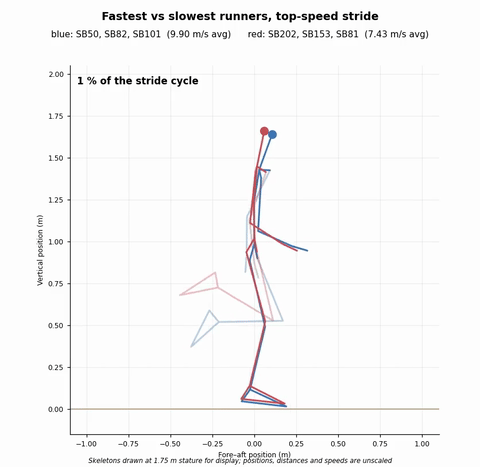
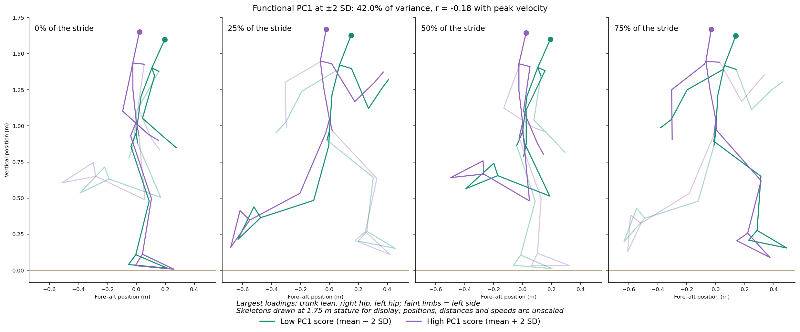
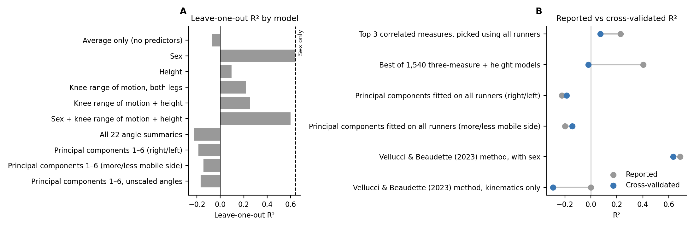
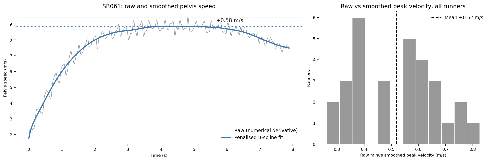

# 60 m sprint pipeline



*Mean-cycle skeleton overlay of the three faster vs three slower athletes (blue = faster). [Source MP4](MP4s/representative_top3_vs_bottom3.mp4)*

30 athletes · Xsens 64 virtual landmarks · 60 Hz · `/opt/anaconda3/bin/python`

**How this repo moves:** read this file first. Keep what is marked **keep**. Next code commit implements **next iteration** only. Recompute every number from data (`sprint_report.py`). Invariant: trial **SB25 = 531 frames, 8.506 m/s**. Permutations = **5,000**. Do not invent body mass. Blue = faster. Knee = ISB (flexion positive).

Google XYZ below: *accomplished **X** as measured by **Y** by doing **Z***.

---

## What it looks like

<table>
<tr>
<td>
<a href="Figures/Block%20Start/block_exit_SB80.png"></a>
<br><sub>SB80 from the set position through block exit and the first three steps.</sub>
</td>
<td>
<a href="Figures/pc1_anatomy.png"></a>
<br><sub>The first principal component of the joint-angle curves, drawn as a runner 2 SD below and 2 SD above the mean at four points in the stride (bodies drawn at 1.75 m for display only).</sub>
</td>
</tr>
<tr>
<td>
<a href="Figures/Report/fig1_validation.png"></a>
<br><sub>How well each pre-specified model predicts the peak velocity of a runner it has not seen, and how much common shortcuts overstate it.</sub>
</td>
<td>
<a href="Figures/velocity_bspline_fit.png"></a>
<br><sub>Pelvis speed with its penalised B-spline. Peak velocity is read from the smooth curve, because the raw signal's peak is mostly noise.</sub>
</td>
</tr>
</table>


## Keep (do not regress)

- Honest LOO + nested selection; every selection or preprocessing step is refit inside the fold (`sprint_report.py`).
- 1.75 m height scale is **drawing only** (animations / fPCA skeletons). Analysis uses measured stature, unscaled velocity.
- OpenSim stays isolated (`sprint_opensim.py`, `OpenSim/`). IK is the kinematic definition check; ID N·m are generic-mass shapes and are not study results.
- Library: `sprint_pipeline.py` functions only, no import-time side effects. No new deps.

---

## Next iteration (the next commit after this README)

Priority order. Each item: keep the good above.

- [x] **Make paths portable and explain the project big-picture-first.** `project_paths.py` now derives the project root, supports environment overrides, and all current modules/notebooks import it. `00_Project_Overview.ipynb` is the reader entry point. Raw data was not moved.
- [x] **Sex is the null model; replicate Vellucci & Beaudette 2023.** The cohort is 15 men / 15 women and sex alone reaches LOO R² ≈ +0.64, so every biomechanical headline is reported pooled, within-sex, and as LOO gain over a sex-only baseline. Notebook 08 re-runs PCA to 95 % → + sex → stepwise on this independent cohort, both in-sample and refit per fold, with 5,000 shuffles.
- [x] **Keep the paper kinematic.** The unvalidated pelvis-velocity / force–velocity branch was removed. No force, power, joint-moment, muscle-force, or model-derived acceleration claim is made without measured ground-reaction force and a criterion velocity system.
- [x] **Consolidate (2026-10-11).** One notebook (`sprint_analysis.ipynb`), one workbook, pipeline checked against Xsens MVN for all 30 runners; split times added; leg-length size check. Result: trunk lean during acceleration adds to sex for 10/20/30 m splits (LOO +0.07–0.10, within-sex p ≤ .002; about half carried by SB202).
- [x] **07: OpenSim on the new strides + per-trial viewer (2026-11-14).** `07_opensim_rerun.ipynb` reuses the whole-trial Scale/IK/MuscleAnalysis artifacts (`OpenSim/Out/`, all 30 runners) and recomputes the stride summary on the `stride.py` windows → new `OpenSim/Out/mtu_summary.csv` (old windows kept as `mtu_summary_oldstrides.csv`). Proof the rerun changed only windows: max |Δ knee r| = 0.0. H6 re-windowed (r(old,new) = 0.849) but still adds nothing to sex (0.716 → 0.694 on 25 QA-passing runners). **Per-trial viewer:** `OpenSim/viewer.html` (self-contained, plotly) — runner picker sorted by speed, IK-agreement curves, 6 key MTU length curves with late swing shaded, excursion-share bars, QA chips; serve with the `opensim-viewer` entry in `.claude/launch.json` (port 8779). Run order 01→08 complete.
- [x] **Sprint scrubber webapp (2026-11-14).** `sprint_viewer.py` builds `sprint_viewer.html` (3.1 MB, self-contained): every trial's 22 joint centres (same `JOINTS`/bones as the MP4 exporter, `draw_at_175` display scaling, true pelvis path) quantised to int16 mm. Frame-by-frame scrubbing with sub-frame interpolation (drag the stage, drag the timeline, wheel, arrow keys, space plays at 0.25/0.5/1×), live step counter + speed/distance/time, sagittal/frontal toggle, and a second-runner overlay — Track (real positions + gap) or Lock (postures superimposed), aligned by same time or same step, blue = faster. The timeline is the speed curve with step ticks (R up, L down), block-phase and top-speed-stride shading. Floor is a rolling 10th-percentile track under the lowest foot point (the PCA alignment leaves ~0.2 m of apparent floor drift over 60 m; a global floor floats the figure). Serve with the `sprint-viewer` launch entry (port 8780) or open the file. v2 (same day): Inter typography, sliding-pill segmented controls with hover/press feedback, dual metric HUDs when comparing (primary left, comparison right, each at its own clock), and a side velocity panel — full speed-vs-time chart, both curves, live cursor + value-labelled dots, click to seek. v3 (same day), renamed **60m Sprint UI**: runners coloured by top speed on a blue→red heat ramp (**in this app red = faster — the opposite of the repo's figure rule, at Shun's request**; printed figures keep blue = faster); a 3D view (C3D-style dark viewport, floor grid, drag orbits, wheel zooms, camera follows the runner) beside Side/Front; velocity panel now toggles from the header and resizes by dragging its edge; scrubbing gained momentum + a mechanical-watch rubber-band — overscroll past either end bounces back; +/−/Reset buttons on the stage so zoom can't get lost. v3.1: skeleton lines back to the ink look (heat colours stay on the HUDs and velocity curves; nothing measured changed). v3.2: the primary skeleton now uses the repo's classic drawing convention — black axial, red right limbs, faint green left limbs (LEFT_ALPHA 0.35), black head dot — in 2D and (lightened for the dark viewport) in 3D; the comparison runner keeps its heat colour so the two stay tellable apart. Visual only. v4: the skeleton is the full Chris V. 64-marker mesh (bone polylines from MATLAB `xsens_scr_video.m`, kept in `(4) Archive/Shun's Sprints Code/sprint_animation.py`) — all 64 markers packed (page 8.3 MB, was 3.1), axial ink, **right limbs red, left limbs blue** (Shun's pick, replacing the red/green MP4 convention); ghost stays one faint colour. Visual only again — metrics, events and speed untouched. On 2026-11-15 the same mesh went into `sprint_outputs.py` itself: `AXIAL_IDX/RIGHT_IDX/LEFT_IDX` are now the 64-marker polylines and `_Skeleton`/`_draw_raw64` draw raw markers (no `joints()` reduction, no head dot), so every figure and MP4 renders the mesh. Regenerated: the three representative MP4s, the hero GIF (`Media/`, ffmpeg palette, one stride loop), all 30 block-exit figures, and notebook 08 (`fast_vs_slow_demo.png`). Group colours stay blue = faster / red = slower in figures. Not regenerated: per-trial MP4s and the fPCA anatomy figures (need the full output run). **Published** (2026-11-14, at Shun's request) as `docs/index.html` on the public `ML-Biomechanics-Comprehensive-Analysis-of-the-60m-Sprint` repo, live at https://shunnchenn.github.io/ML-Biomechanics-Comprehensive-Analysis-of-the-60m-Sprint/ — the page embeds all 30 runners' de-identified joint-centre motion plus sex and top speed. On the same day the whole current pipeline was committed there as `Pipeline/` (commit bfab1e5: code, notebooks 01–08, Figures, MP4s, Media, OpenSim Logs/Models/Setup/Out + viewer; the repo README now fronts the UI link and the animations). Held out of the public repo: the raw trials folder (C3D/MVN + anthropometrics sheet), OpenSim/TRC per-participant marker files, and the cohort pickle caches — raw/near-raw participant data.
- [x] **Tuning, collinearity, demo (2026-11-14).** 05 gained honest (nested) tuning: the feature-set search picks plain contact time in 30/30 folds and the fPCA-mode search picks k = 2 in 30/30 (0.667 → 0.674) — nothing left for hyperparameters to find. New `06_collinearity.ipynb`: as-modelled set clean (all VIF < 5); stride frequency = 1/(contact+flight) explodes VIF to ~140 when added; full-set VIF at n = 30 is degenerate (median 58) — never report it; model-1 coefficients stable across folds (cv 2–7%). New `08_fast_vs_slow_demo.ipynb` (07 reserved for the OpenSim re-run): speed curves, 1.75 m-normalised skeleton overlays, top-3 angle gaps, within-sex fair comparison (contact time carries the gap in both sexes: −23 ms M, −32 ms F); hero figure `Figures/fast_vs_slow_demo.png`. Run order 01→06, 08.
- [x] **Three models + CamelCase folders (2026-11-13).** `05_three_models.ipynb`: (1) OLS sex + contact time, LOO R² 0.726 vs sex 0.642, within-sex p = 0.001; (2) ridge sex + fold-refit fPCA, 0.667; (3) step-mechanics identity v = stride length × frequency as a measurement-consistency check, 0.778 — its one outlier is SB74, the runner with 7 missed contacts. Run order 01→05. Folders are now CamelCase (`Figures/ Media/ MP4s/ Results/ OpenSim/{Logs,Models,Out,Setup,TRC,Work}`), code/README references updated; SSAC write-up files moved to `(3) …/Abstracts, Manuscripts/`; old analysis callable again via `sprint_outputs._sprint_report()`.
- [x] **Analysis on the new events (2026-11-12).** `cohort.py` (ETL, cache `Results/cohort_events.pkl`) + `04_analysis.ipynb` (EDA → ETL → ML, OpenSim optional). Top speed and sex baseline unchanged (sex LOO R² 0.642). Knee ROM + stature falls 0.256 → 0.031 on the corrected strides. Top-speed contact time adds to sex: 0.642 → 0.726, within-sex p = 0.0008 (Holm 0.0024, 3 exploratory tests), +0.10 without SB74/SB111/SB155. OpenSim CSV still on the OLD stride windows.
- [x] **Event utilities (2026-11-12).** `stride.py` detects ground contact (lower of heel/toe within 3 cm of a rolling-10th-percentile floor AND < 1.5 m/s), the Kinogram Notes block/acceleration events and the ALTIS top-speed positions. `sprint_summary.py` gives the run's timeline and headline numbers. Notebooks `01_globalization` → `02_acceleration_utility` → `03_top_speed_utility` show and self-check them on SB80. Feet alternate cleanly in 26/30 runners (SB74, SB111, SB155, SB161 have missed contacts). Finding: `find_top_speed_strides` centres on the raw speed peak (SB80: 36.0 m) instead of the smoothed one (48.9 m). Next build: switch the models to these events, OpenSim as an optional section, notebook as EDA → ETL → ML. The previous analysis (`sprint_analysis.ipynb`, `sprint_report.py`, `sprint_opensim.py`, `Sprint_60m_Report.pdf`) moved to `(Deprecated)/` on 2026-11-12; run it from the Pipeline root with `PYTHONPATH=. python "(Deprecated)/sprint_report.py"` if needed.
- [x] **Presentation pass (2026-10-18, no new analyses).** Every figure is one `sprint_outputs.fig_*` function shared by the notebook and the report; titles are short sentence-case descriptions, axes carry readable names and units, and claims and statistics live in the captions (Journal of Biomechanics convention). The notebook keeps only the analysis blocks; its next-steps and rubric sections moved below.

**Replan (2026-10-11, no new data).** No further collection, and MVN floor settings stay as recorded. With n = 30, the smallest effect detectable at 80 % power is r ≈ 0.50 (r ≈ 0.67 within one sex), so the plan extracts new *variables* and more *observations* from the 31 existing recordings, and replaces replication with robustness checks.

**Pre-registration (written 2026-10-11, before any of these were computed).**

Variables are computed on the 5 top-speed strides (right side, mean cycle, B-spline smoothed) unless stated otherwise.

| ID | Hypothesis | Exact variable | Direction |
|---|---|---|---|
| H1 | v_peak ~ sex + thigh retraction | `thigh_retract_dps` = −min d(hip_R)/dt over 70–100 % of the cycle (late swing), in deg/s; dt = stride time / 100 | + |
| H2 | v_peak ~ sex + knee extension in late swing | `knee_ext_dps` = −min d(knee_R)/dt over 50–100 % of the cycle, in deg/s | + |
| H3 | v_peak ~ sex + touchdown distance | `td_dist_m` = fore-aft (lowest foot landmark − pelvis centroid) at right-foot touchdown (heel/toe band onset), in m, mean over top-speed contacts; leg length as an extra covariate | − |
| H4 | t10 ~ sex + shank angle at touchdown | `shank_td_deg` = sagittal angle of ankle→knee from vertical at touchdown of steps 1–3 (positive = knee ahead of ankle), mean | − (more forward shank, shorter t10) |
| H5 | v_peak ~ sex + arm–leg coordination | `crp_armleg_deg` = mean \|continuous relative phase\| (Hilbert phase) of shoulder_L vs hip_R over the cycle | two-sided |

| H6 | v_peak ~ sex + hamstring stretch speed | `bflh_lengthen_Lps` = peak lengthening velocity of the right biceps femoris long head (gait2392 `bifemlh_r`) over 70–100 % of the cycle (late swing), in muscle–tendon lengths per second, from OpenSim inverse kinematics + muscle analysis (kinematic only: no mass, no force) | + |

H6 was added 2026-10-11, before any muscle–tendon value was computed. It is its own test family (alone), so the Holm correction across H1–H5 is unchanged.

**Test, the same for H1–H5.** Leave-one-out R² of sex + variable against sex alone (ΔLOO); within-sex permutation p for the gain (5,000 shuffles); Holm correction across H1–H5.

**Success requires all four:**
- Holm-adjusted p < .05;
- the sign is as predicted (H5: either sign);
- ΔLOO > 0;
- the demotion rule below passes.

**Demotion rule, applied to every lead including the existing ones (trunk lean in acceleration, normalised step frequency).** A lead is reported only as "hypothesis-generating, not robust" if either:
- ΔLOO without its most influential runner is below +0.03, or
- the bootstrap 95 % CI of ΔLOO (2,000 resamples) includes 0.

**Exploratory only, with no hypothesis:**
- frontal/transverse angles (Xsens `Joint Angles ZXY`: hip ab/adduction and rotation, pelvis and trunk rotation), through the sex-adjusted screen with FDR;
- the step-level mixed model (step speed ~ trunk lean + step frequency, runner random intercept, within/between split);
- reliability-corrected correlations;
- SPM on sex-residualised v_peak and on the 1-3-5 acceleration cycle (trunk_lean, knee_R, hip_R).

**Amendment 1 (2026-10-11, after the first run, made for implausible values and not because of results).**

H3/H4 touchdown originally used the trial-wide floor (2nd percentile), which drifts 3–5 cm along 60 m. That put touchdown up to 3 frames late, and at top speed 1 frame is 0.14 m of pelvis travel. Mean foot-to-pelvis distance came out at 0.04 m (range −0.38 to +0.34), which is not physiological.

Touchdown now uses a local floor (minimum within ±10 frames of each contact) and a sub-frame crossing time. The ballistic step boundaries also now use foot-centre troughs at both ends, matching the feasibility test.

**Amendment 2 (same day, same reason).** After the fix, 5/30 runners still had touchdown distances ≤ 0 m (foot at or behind the pelvis at touchdown, which is impossible), because ±1 frame at 60 Hz is ±0.14 m. Instead of changing the detector again, a plausibility check was added: if more than 10 % of runners fall outside the variable's physiological band, the verdict is "not measurable at 60 Hz", not "not supported".

Original (uncorrected) results, kept for the record:

| | ΔLOO | p |
|---|---|---|
| H3 | −0.034 | .85 |
| H4 | −0.035 | .89 |

**Amendment 3 (same day, after the first H6 run).** 5/30 runners had poor OpenSim IK fits (knee or hip r < 0.95 against the pipeline, or marker RMS > 35 mm): SB111, SB16, SB202, SB91, SB92. Their muscle–tendon values are excluded (n = 25). Uncorrected H6 (n = 30), kept for the record: ΔLOO −0.014, p = .45.

**Contact time (decided before running).** The analysis definition is the heel/toe band (old 04/05, mean ≈ 96 ms, stride ICC 0.54). Three alternatives stay as a sensitivity check:
- the foot-centroid band;
- the lowest foot landmark's horizontal speed < 1.5 m/s, with sub-frame timing;
- ballistic CoM, with a 2 mm tolerance.

Any contact-time result is reported for all four. Absolute values are quoted as the across-method range.

**Stop / do not retry:**
- the model zoo on the same features (Ridge, Lasso, ElasticNet, SVR, random forest, XGBoost, PLS, SHAP: old `03_Sprint_ML_Analysis`; nested LOO shows nothing beyond sex);
- marker-position PCA;
- 8-stride or all-stride averaging;
- mass-free acceleration (a0, τ, RFmax, DRF), Samozino force–velocity, mono-exponential fits;
- joint moments;
- normalising performance targets for size (`size` sheet: b ≈ 0);
- choosing any definition by its correlation with speed.

### Next (moved from the notebook, 2026-10-18; no new data)

1. **Nothing is yet robust beyond sex.** Under the pre-registered rule, every lead is "hypothesis-generating, not robust": its bootstrap CI includes 0 and/or one runner (usually SB202) carries it. This applies to trunk lean in acceleration (L1–L3: ΔLOO +0.07 to +0.10, p ≤ .001) and normalised step frequency (L4: +0.11, p = .001). Report them as hypotheses with the robustness columns shown, not as findings.
2. **New variables (§5c).** H1 thigh retraction and H2 knee extension are not supported. H3 touchdown distance is not measurable at 60 Hz (±1 frame is ±0.14 m). H4 shank angle (p = .015) and H5 arm–leg coordination (p = .032) are hypothesis-generating; neither survives Holm correction. H6 hamstring stretch speed (OpenSim, n = 25 after IK QA) is not supported. fPCA without per-angle standardisation makes PC1 arm separation rather than trunk lean, and still does not predict (LOO −0.17).
3. **Within runners (§5c mixed model).** As a runner speeds up, the trunk becomes more upright and steps quicker; both within-runner effects are tightly estimated from about 1,000 steps. Runners differ only a little in speed gained per degree of straightening (random-slope SD 0.015 vs mean −0.074); those who gain more tend to be faster for their sex (r = −0.38, p = .037, exploratory).
4. **Contact time (§6).** Analysis definition: heel/toe band (mean 96 ms, stride ICC 0.54); sensitivity definitions span 66–114 ms. No definition adds to sex robustly (`contact_robustness`), so contact time is descriptive.
5. **SPM.** With sex held constant, no top-speed cluster remains. In the acceleration cycle, trunk lean across the whole cycle relates to the sex-adjusted 10 m split (cluster p = .0004), the time-resolved form of lead L1.

**Visualization rubric (self-scored, so biased).** Units, consistent colour coding, labelled axes, and whether the figure answers its question, scored 0–10 by the figures' author; perception needs a blind reader and is not scored. Last scored before the 2026-10-18 presentation pass: cohort 9, screen 8, stride r-curves 8, fast vs slow 7, model ladder 9, Xsens agreement 9.

---

## Notebook and results

Five modules, one notebook, one workbook, one report. One cohort pass (`sprint_report.py`) feeds everything else.

| File | Role |
|---|---|
| `project_paths.py` | locations |
| `sprint_pipeline.py` | preprocessing and model primitives (C3D → cleaned markers → strides → angles → fPCA, LOO, SPM) |
| `sprint_report.py` | every reported number → `Results/sprint_results.xlsx` |
| `sprint_opensim.py` | OpenSim gait2392 scale → IK → muscle–tendon lengths, all runners (kinematic only) |
| `sprint_outputs.py` | figures, MP4s and `Sprint_60m_Report.pdf`, all read from the report cache |

```bash
python sprint_opensim.py         # ~3 min: OpenSim IK + muscle-tendon lengths -> OpenSim/Out/mtu_summary.csv
python sprint_report.py          # ~3 min: C3D + Xsens xlsx (+ mtu_summary) -> Results/sprint_results.xlsx (+ Results/cohort.pkl)
jupyter nbconvert --to notebook --execute --inplace sprint_analysis.ipynb   # ~20 s, reads the cache (kernel: anaconda3)
python sprint_outputs.py --report      # ~10 s: Sprint_60m_Report.pdf (StealIQ format) + the `evidence` sheet
python sprint_outputs.py --no-trials   # figures + group MP4s (drop the flag to also render the 30 trial MP4s)
```

- **`sprint_analysis.ipynb`** — the one notebook. It runs exploratory first (cohort/QA → screen with sex held constant → where in the stride → within-sex fast vs slow), then out-of-sample prediction, pre-registered hypotheses, muscle–tendon kinematics and measurement validity. Figures come from `sprint_outputs.fig_*`.
- **`Results/sprint_results.xlsx`** — every reported number, one sheet per table, `runner_id` first.
  - Per runner: `athletes`, `qa`, `xsens`, `muscle_mtu`, `contacts`.
  - Screens: `screen`, `screen_accel`, `screen_mtu`.
  - Models: `models`, `accel`, `leakage`, `prespecified`, `contact_robustness`, `steps_mixed`.
  - Measurement: `fpca`, `spm`, `reliability`, `contact_defs`, `size`, `eval`.
  - Literature: `evidence` (each claim against the 390-draft sources).
- **`Sprint_60m_Report.pdf`** — a short report in the StealIQ paper format, with every number read from the workbook.
- Notebooks `00`–`08` and `sprint_pipeline.ipynb`, plus the old `Results/*.csv`, were consolidated on 2026-10-11 and moved to `(4) Archive/Pipeline notebooks (pre 2026-10-11)/`. Their headline numbers reproduce in the workbook (sex 0.641, knee ROM + height 0.256, search 0.403 → −0.020, V&B in-sample 0.688, PCA-only −0.292, ICC 0.802 → 0.359).

---

## Library (`sprint_pipeline.py`)

| Section | What | Why / How |
|---|---|---|
| 1–3 Load / clean | C3D → metres, SVD travel axis, trim 62 m | Removes units, lane drift, standing around |
| 4 Strides | Top-speed same-foot; first steps alternate-foot | Top speed is cyclic; accel legs do different jobs |
| 5 Angles | 13 sagittal, ISB | Size-free; do not silent-flip signs |
| 6–8 fPCA / scalars | B-spline smooth, HI/LO recode, ROM/means | Variance ≠ prediction; HI/LO avoids smearing sides |
| 9 Velocity / scalars | `peak_velocity_smoothed`, `scalar_features` | One row/athlete; velocity unscaled |
| 10 Models | LOO, nested CV, 5,000 perm | Honest small-n |
| 11 SPM | Pointwise r + cluster perm | *Where* in the cycle |
| 12 Contact helper | Kinematic foot-height event estimates | Sensitivity checks only; not force-plate events |

`sprint_opensim.py`: TRC/Scale/IK/ID wrappers. `sprint_outputs.py`: Figures/MP4s.

### Portable paths (`project_paths.py`)

- Derives `Pipeline/` and the project root from `project_paths.py`; moving the whole project does not require editing source. `Pipeline/` sits at the project root alongside the numbered folders; the project root is the nearest ancestor containing `(2) Data (C,P,A)`.
- Prefers data under `(2) Data (C,P,A)/31 Trials Data Folder`. A symlink at the old root name `31 Trials Data Folder` remains so leftover scripts still resolve.
- Resolves `(1) Research Resources` and `(3) Manuscripts, Presentations` directly.
- Override locations without editing code:

```bash
export SPRINT_PROJECT_ROOT="/path/to/60m Project Folder"
export SPRINT_DATA_ROOT="/path/to/data"
export SPRINT_C3D_DIR="/path/to/c3d"
export SPRINT_ANTHRO_PATH="/path/to/anthropometrics.xlsx"
export SPRINT_MANUSCRIPT_DIR="/path/to/manuscripts"
export SPRINT_OPENSIM_CMD="/path/to/opensim-cmd"
```

`sprint_report.py` writes through `PATHS.results`, not the kernel working directory.

---

## Other tracked artefacts

- `Media/` — README hero GIF (made from `MP4s/representative_top3_vs_bottom3.mp4`).
- `Results/sprint_results.xlsx` — every reported number (see Run).
- `SSAC27_Abstract_revised.{md,pdf,tex}` — Sloan draft; numbers must match the workbook after any upstream change.
- `OpenSim/` — gait2392 model, per-runner TRC / scale / IK / muscle–tendon length outputs (`python sprint_opensim.py`); `Out/mtu_summary.csv` feeds the workbook.
- `(3) Manuscripts, Presentations/Abstracts, Manuscripts/60m_Global_Sprint_Technique_Manuscript.md` — current big-picture-to-detail write-up (`.docx` built from it with pandoc); legacy claims are explicitly retained, corrected, or retired.
- **Legacy.** `(4) Archive/Shun's Sprints Code`, `(4) Archive/Old Outputs` and `(4) Archive/Pipeline notebooks (pre 2026-10-11)` are context only; cite the workbook, never their numbers. Claims they made that are retired or corrected:
  - SVR R² ≈ 0.47: honest LOO is +0.256 for knee ROM + height, and sex alone is 0.641;
  - exhaustive-search R² 0.403: nested −0.020;
  - selected PCs as predictors: no fPC model beats the intercept;
  - position fPCA: PC1 was body size;
  - "more strides = more reliable": the ICC median falls from 0.80 (5 strides) to 0.36 (all);
  - stance-ROM findings: a window-length artefact;
  - model-derived acceleration / force–velocity, and joint moments or muscle forces: no mass or GRF.
- `(4) Archive/Shun's Sprints Code` and `(4) Archive/Old Outputs` — historical archive (symlinks remain at the old root names). Use for qualitative context; do not cite old ML scores over 05/07.

---

## Run

```bash
/opt/anaconda3/bin/python -c "import sprint_pipeline; print('ok')"
```

C3D / `clean_for_angles` / `opensim-cmd` need an unsandboxed process (numpy SVD SIGBUS in the sandbox). OpenSim: `/Applications/OpenSim 4.5/bin/opensim-cmd`.
